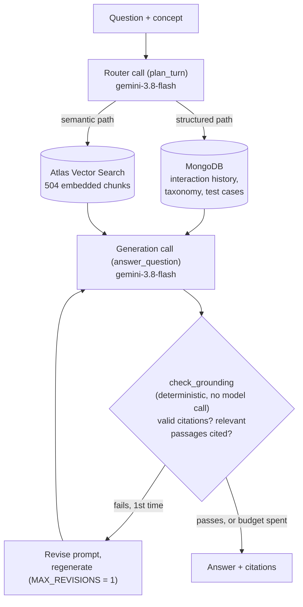

# AI Socratic Evaluator

A debugging tutor that generates Python containing one deliberate logic
bug, then helps a student find it by asking rather than telling. It runs
the student's fix against executable test cases before saying anything
about it, grounds its explanations in passages retrieved from a CS corpus,
and cites the ones it used.

Deployed on Cloud Run. Built on **MongoDB Atlas Vector Search** and
**Google Vertex AI** (`gemini-3.8-flash`, `gemini-embedding-001`).

---

## Architecture



One model plans the retrieval path, one model generates the answer and
self-reports its own citations and relevance. `check_grounding` is a
plain Python function, not a second model call — it checks the first
call's citations against the passages it was actually given and can send
the prompt back once. This is a router plus a self-revising generator,
not a multi-agent system; nothing here claims otherwise.

---

## What makes it more than a RAG demo

**Two retrieval pipelines, chosen per turn.** "Why does `high = mid` loop
forever?" has an answer that must be read and understood — that goes to a
`$vectorSearch` over 504 embedded chunks of CS textbook material. "Which
concepts do I fail most often?" is a computation over records that no
embedding can answer — that goes to an Atlas aggregation. A coordinator
reads the turn and picks. Routing accuracy is measured below.

**Correctness comes from running the code, not reading it.** Whether a fix
works is a question with an answer, and inferring it from source is what
language models are least reliable at. Every evaluation executes the
student's code against that concept's test cases first; the result is the
verdict, and the model's own reading is recorded beside it so the two can
be compared.

**Citations are checked, and failures are repaired.** The critic is given
passages with ids and must cite the ones it used. Every cited id is
verified against what was actually supplied. An invented id, or an answer
that ignores relevant passages, is sent back exactly once with the problem
named.

**It declines what the corpus does not cover** — and the measurement below
shows why that could not have been done with a similarity threshold.

---

## Measured

From `python -m scripts.run_eval --all`. Raw report:
[`eval/results/run.json`](eval/results/run.json).

### Retrieval

28 questions across all 22 concepts, each naming the documents that could
honestly answer it (2.4 on average).

| | hit@1 | hit@5 |
|---|---|---|
| with concept filter | 93% (26/28) | 100% (28/28) |
| **without concept filter** | **89% (25/28)** | **100% (28/28)** |

Median query latency **208 ms**, embedding included.

The unfiltered row is the one worth quoting. Dropping the metadata filter
costs four points, so the embeddings are carrying retrieval and the
concept tags refine rather than rescue it. An earlier version of this eval
matched on repository prefix instead of document; with the filter applied
that was nearly free, and it reported 90% while measuring almost nothing.

### Refusal, and why a score threshold cannot do this

12 questions the corpus genuinely cannot answer — Raft, TCP congestion
control, red-black rebalancing — each a real CS question a student might
ask, each verified absent by hand. Four are deliberate near-misses, like
bloom filters against nine ingested hashing documents.

| | |
|---|---|
| correct refusal | **12/12** |
| fabricated citations | **0** |

The interesting part is the score distribution. On these unanswerable
questions the top retrieved passage scored a **median of 0.80 and a
maximum of 0.83**. On answerable questions scores sit around **0.82–0.87**.

Those ranges overlap almost entirely. **No value of a similarity threshold
separates them**: any cutoff high enough to reject Raft would also reject
real questions about binary search. `MIN_PASSAGE_SCORE` is therefore left
low and does no work.

The refusals come from the critic reading passages it was handed,
recognising they do not address the question, and saying so — recorded
structurally in a `material_relevant` field rather than inferred from its
prose. That distinction also stopped a bug: before the field existed, the
grounding check treated every refusal as an ungrounded answer and spent a
retry on ten of the twelve.

### Routing

12 questions whose correct retrieval path is known.

| | |
|---|---|
| correct path | 83% (10/12) |
| correct tool, where one is specified | 100% (10/10) |

Both misses are the two questions that need *both* paths — "why do I keep
getting binary search wrong" wants the student's history for the pattern
and the corpus for the explanation, and the router picked structured only.
Single-path routing is perfect; combining paths is the weakness.

### Critic

44 reference implementations — one correct and one carrying the documented
misconception, for each of the 22 concepts
([`eval/references.py`](eval/references.py)).

| | |
|---|---|
| verdict correct | 44/44 |
| the model's reading agreed with the test run | 44/44 |
| cited a passage it was actually given | 39/44 |
| cited nothing | 5/44 |
| citations made | 51 |
| citations referring to a passage never supplied | **0** |

Groundedness was 42/44 before the critic could record that retrieved
passages do not bear on a question. Allowing that judgement moved it to
39/44, because five evaluations now decline to cite rather than reach for
the nearest passage. Whether all five are honest declines or some are a
grounding failure wearing the same clothes is not something this table can
tell you, so the harness reports the split (`declined_material_irrelevant`
against `uncited_unexplained`) and the unexplained ones are worth reading
by hand.

Verdict accuracy mostly measures the test cases, since the verdict comes
from them. The agreement figure needs a caveat: these 44 implementations
are deliberately unambiguous, real student code is messier, and agreement
on clean cases does not predict agreement on ambiguous ones. The honest
claim is that it agreed on all 44 unambiguous cases.

### Cost and latency

| | |
|---|---|
| calls in a full eval run | 92 |
| tokens | 108,557 in / 10,555 out |
| throughput | 196.9 tokens/sec |
| p50 latency | 5.9 s |
| p95 latency | 15.1 s |

Cost per request is computed only when `PRICE_PER_1M_INPUT_TOKENS` and
`PRICE_PER_1M_OUTPUT_TOKENS` are set in `.env`. Those are not hardcoded
because model prices change and a wrong number is worse than none.

### Corpus

| | |
|---|---|
| documents | 54 |
| chunks | 504 (median 1,305 characters) |
| chunks with no concept tag | 156 |
| embedding | `gemini-embedding-001`, 768 dimensions, cosine |
| ingest throughput | 17.2 chunks/sec |
| test cases | 79 across 22 concepts |
| interaction records | 119 |
| licences | MIT, PSF-2.0 |

---

## Deployment

Three Cloud Run services, all scale-to-zero.

| Service | Public | Credentials | Role |
|---|---|---|---|
| `socratic-ui` | yes | none | Streamlit front end |
| `socratic-api` | yes, rate-limited | Mongo URI, Vertex SA | retrieval, tutor, taxonomy |
| `socratic-sandbox` | **no** | **none** | executes untrusted code |

`/api/run` and `/api/evaluate` both execute arbitrary Python from the
request body. Running that beside a Mongo connection string and a
Vertex-capable service account means any submission can read both. Both
paths go through `socratic/sandbox_client.py` to a sandbox service that
has no credentials, an image containing two Python files and FastAPI, a
service account with zero IAM roles, and `--no-allow-unauthenticated` so
Google's edge rejects every caller but the API.

Grading originally did not: `verify.py` called the in-process
executor directly, so every graded submission ran inside the API with the
credentials beside it, while only the Run button used the sandbox. The fix
is one import. It was found by tracing every caller of the executor rather
than trusting the module boundary, and is verified by grading all 44
reference implementations against a local sandbox with the in-process
executor replaced by one that raises: 66 sandbox calls, zero in-process
runs, identical verdicts.

The API **refuses to start** without `SANDBOX_URL` when it detects it is
deployed. Falling back to in-process execution is right on a laptop and
wrong on a public URL, and nothing at the call site distinguishes them.

Full runbook, including what this does *not* protect against:
[`deploy/README.md`](deploy/README.md).

```bash
./deploy/deploy.sh setup   # APIs, service accounts, secret, registry
./deploy/deploy.sh all     # build and deploy all three
```

---

## How retrieval is built

**Structure-aware chunking**
([`socratic/chunking.py`](socratic/chunking.py)). Fixed-width splitting
cuts code blocks in half and strands explanations from the heading that
says what they explain; retrieval quality then looks like a model problem
when it is a chunking problem. This keeps fenced code intact, splits on
heading boundaries first, prefixes each chunk with its heading trail, and
hard-splits anything approaching the embedding input ceiling so no chunk
is silently embedded as a partial.

**Chunk-level concept filtering**
([`corpus/signals.py`](corpus/signals.py)). Document-level tags are right
for "this page is about hashing" and wrong for a vector-index filter.
CPython's programming FAQ is a legitimate source for three Python concepts
and is also 56 chunks, mostly about threading and string formatting.
Tagging all 56 lets a search scoped to Python Lists return a passage with
nothing to cite — which reads as a bad embedding model but is bad
metadata. Each chunk earns its tags through evidence, cutting Python Lists
from 139 candidates to 45 and SQL Left Join from 102 to 33.

**Asymmetric embedding.** Documents use `RETRIEVAL_DOCUMENT`, queries use
`RETRIEVAL_QUERY`. A question and the passage answering it are not the
same kind of text.

**Idempotent ingest.** Deterministic ids, upserts, and a stored content
hash alongside the embedding model and dimension, so a re-run embeds only
what changed. Metadata is written separately from vectors, so widening a
signal set corrects tags without paying to re-embed.

---

## Test cases

79 cases across all 22 concepts
([`data/test_cases.json`](data/test_cases.json)). Each concept has at
least one case written to fail on its specific misconception and pass on a
correct implementation.

Three of the misconceptions return perfectly correct output and differ
only in work done — a bubble sort missing its early exit, a selection sort
swapping in the inner loop. Those are caught by a list subclass counting
reads and writes. The binary-search off-by-one does not return anything
wrong either; it hangs, so that case runs in its own process and is judged
on whether it terminates.

`python -m scripts.validate_test_cases` runs every case against both
reference implementations. That check found five problems in the first
draft: four compared a tuple against a JSON list and failed *correct*
implementations, and every heap-sort case passed the buggy one, because
1-indexed child arithmetic still sorts about 80% of random inputs.
`[1, 2, 3]` is the smallest input that distinguishes them.

---

## Running it locally

Needs a Google Cloud project with Vertex AI enabled and a MongoDB Atlas
cluster. Free M0 is sufficient — vector search works on it and this uses
one of its three allowed search indexes.

```bash
cp .env.example .env               # GCP_PROJECT and MONGO_URI
gcloud auth application-default login

python -m scripts.check_models     # verify the model ids resolve
python -m scripts.bootstrap_db     # collections and the vector index
python -m scripts.migrate_sqlite   # taxonomy and interaction history
python -m scripts.build_corpus     # fetch and convert upstream sources
python -m scripts.ingest_corpus    # chunk, embed, upsert
python -m scripts.seed_test_cases  # load the test cases

uvicorn main:app --reload --port 8000
streamlit run app.py
```

`GET /api/health` checks Mongo, the chunk count, whether the index is
queryable, and which execution mode is active.

Inspect retrieval without the UI:

```bash
python -m scripts.try_search "why does high = mid loop forever"
python -m scripts.try_search --structured "Binary Search (Off-by-One)"
python -m scripts.run_eval --retrieval
```

---

## Corpus and licensing

Public repository, so every source is permissively licensed and that was
checked before ingesting.

| Source | Licence | Covers |
|---|---|---|
| [OpenDSA](https://opendsa.org) | MIT | searching, sorting, hashing, graphs, recursion, ADTs |
| [CPython docs](https://docs.python.org/3/) | PSF-2.0 | Python language semantics |
| [SQLAlchemy docs](https://www.sqlalchemy.org/) | MIT | SQL joins and grouping |

**PY4E is excluded.** OpenDSA vendors those chapters, but they are Charles
Severance's under CC BY-NC-SA and OpenDSA cannot relicense someone else's
work by including it. Non-commercial and share-alike are both unwanted
here, so CPython's own documentation serves the Python concepts — which is
the better source anyway, since `tutorial/controlflow.rst` documents the
mutable-default trap directly.

**OpenDSA's SQL chapter is unusable.** It is entirely interactive
JavaScript slideshows; `SQLJoin.rst` is three directives and a heading and
converts to 18 characters of text.

**The converted corpus is not committed.** `corpus/sources.py` plus
`scripts/build_corpus.py` reproduce it exactly, so the repository carries
the method rather than a copy of three documentation projects.

---

## Known issues

**The generator is not verified.** Nothing checks that a generated
exercise actually contains the misconception it claims to. Observed
failing: a Hash Tables exercise chained correctly and injected a list
nesting bug instead of the documented collision overwrite. The exercise
was still broken and teachable, but it taught the wrong lesson. The fix
is to run the concept's test cases against the generated code and
regenerate if the targeted case does not fail — not yet built.

**The sandbox has outbound internet access.** Cloud Run allows egress by
default and blocking it needs a VPC connector with no NAT route, which is
not in the free tier. The sandbox has nothing worth exfiltrating, but it
could be used as a traffic source.

**The per-IP rate limit can be sidestepped.** It keys on the leftmost
`X-Forwarded-For` entry, which a caller can supply. The 500-a-day total is
keyed on the date alone, so spend stays bounded, but one caller could use
the whole day's allowance. The fix is to count from the right past known
proxies, once the header shape Cloud Run delivers is confirmed from a
logged request rather than assumed.

**`/api/run` is not rate-limited.** Only endpoints that call a model are
metered. Running code costs sandbox compute, not model tokens, and the
sandbox caps it at five instances with one program each, but combined with
open egress it is the route by which the sandbox could be used as a
traffic source.

**Student history is not authenticated.** A student id is 48 random bits
generated in the browser session, and `/api/history/{student_id}` returns
that id's records to whoever presents it. Unguessable in practice, but it
is a bearer token in a URL, not an account.

**Atlas accepts connections from anywhere.** Cloud Run egresses from
Google's address pool, so the access list is `0.0.0.0/0` and the database
credentials are the only protection. A static egress IP needs a VPC
connector and Cloud NAT, neither free.

**p95 latency is 15.1 s** against a p50 of 5.9. Gemini 3.x reasons before
answering with no budget set, and the embedding call and taxonomy lookup
run serially when they could overlap.

**Routing does not combine paths.** Questions needing both the student's
history and the corpus get one of the two.

**72 of 119 interaction records cannot be attributed to a specific
misconception.** They are logged against a bare `"Binary Search"`, which
is not a taxonomy concept. The migration keeps the label and adds a
`concept_family`, but no per-variant claim can be made about the largest
block of real data here. The original schema also had no student
identifier, so all 112 migrated rows sit under one id.

**Chunk ids come from filenames, not sections.** A passage about
sequential search cites as `opendsa:Searching_BinarySearch#0`, because
OpenDSA puts both algorithms in one file.

---

## Layout

```
socratic/          the application
  coordinator.py   routes the turn, revises ungrounded answers once
  retrieval.py     both pipelines, as separately callable tools
  tutor.py         exercise generation and Socratic evaluation
  verify.py        runs test cases against student code
  chunking.py      structure-aware splitter
  vertex.py        model access, retries, token accounting
  db.py            Atlas collections and index bootstrap
  execute.py       code execution, and what it is not
  sandbox_client.py  calls the sandbox service; refuses to fall back
  ratelimit.py     per-IP and daily caps on the metered endpoints
  history.py       interaction logging
sandbox/           the execution service, deployed on its own
corpus/            build-time only; nothing here runs at request time
  sources.py       which documents, which concepts, which licence
  signals.py       per-chunk concept evidence
  rst.py           reStructuredText to Markdown, without Sphinx
eval/              ground truth and question sets
deploy/            Cloud Run scripts and the runbook
scripts/           setup, ingest, and measurement
```
